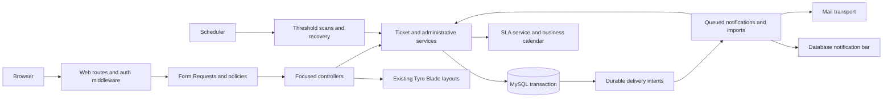

# Application architecture

## Baseline and design

See [evidence baseline](01-README.md). This is an app integration project, not a Tyro framework fork. Use a Laravel 13 monolith, MySQL/InnoDB, server-rendered Tyro Blade ticket pages, session authentication, database queues initially and private Laravel Storage. Keep existing Inertia infrastructure for the welcome page. Redis, search services, microservices and a repository abstraction are not initial dependencies.

## Target application structure

| Location | Responsibility |
| --- | --- |
| `routes/web.php` | Named app routes grouped by authenticated access; preserve home |
| `routes/console.php` | Schedule bounded SLA scans, delivery recovery and safe cleanup |
| `app/Http/Controllers/Tickets/` | Ticket, assignment, transition, conversation, attachment and bulk endpoints |
| `app/Http/Controllers/Admin/` | Users, roles, categories, priority, calendar/policy publishing, imports and analytics |
| `app/Http/Requests/` | Input shape, per-operation rules and initial authorization |
| `app/Policies/` | Record-level access and action authorization, including archive/restore |
| `app/Services/Tickets/` | TicketService (create, content/status/priority/category changes), AssignmentService (manual/automatic assignment and claim), ConversationService, AttachmentService |
| `app/Services/Admin/` | UserService, RoleService, CategoryService, PriorityService, CalendarService, SlaPolicyService; shared guarded RecordLifecycleService only where it removes actual duplication |
| `app/Services/Sla/` | SlaService owns SLA projection/escalation decisions; BusinessCalendar performs pure arithmetic with immutable inputs and an explicit clock |
| `app/Services/Imports/` | TicketImportService owns CSV run/checkpoint orchestration and delegates each ticket creation to TicketService |
| `app/Services/BulkOperations/` | BulkOperationService processes bounded selections per record and returns current-request results; it does not persist batch history |
| `app/Services/Notifications/` | NotificationDeliveryService owns durable delivery/channel coordination; Laravel Notification classes own channel formatting |
| `app/Services/Authorization/` | EffectivePermissionService and minimal TyroAccessAdapter |
| `app/Services/Analytics/` | Role-scoped dashboard aggregates, Dhaka date windows, resolution snapshots and bounded admin cache |
| `app/Enums/` | TicketStatus, MessageVisibility, interval/escalation states, import states |
| `app/Models/` | Typed relationships, casts, explicit scopes; no SMTP/storage side effects in model observers |
| `app/Jobs/`, `app/Events/`, `app/Listeners/`, `app/Notifications/` | Named async boundaries described in background-processing |
| `resources/views/dashboard/` | App ticket/admin pages extending existing Tyro layouts |
| `resources/views/vendor/tyro-dashboard/` | Existing overrides: minimal menu, bar, routing adaptations only |
| `config/ticketing.php` | Infrastructure limits/defaults; business policy versions live in DB |
| `tests/Feature/`, `tests/Unit/` | Named scenarios; isolated MySQL integration group |

Create directories through normal future Laravel generators only when needed. Do not restructure starter files merely for symmetry. Services use constructor injection and explicit typed inputs/results; introduce DTOs only when they reduce ambiguity across HTTP/import/job callers. Controllers coordinate request → policy → service → redirect/view. Services recheck mutable invariants within transactions; jobs call the same services, not duplicate business logic. References such as `TicketService::create` identify an instance-method responsibility, not a requirement to implement static methods or facades.

## ADR01 — Spatie is the sole authorization authority

Spatie is the sole grant store. Installed version is **8.3.2** (PHP 8.4.27, Laravel 13.39.0); `config/permission.php` uses the app Role/Permission models and `access_*` table names. Official [compatibility documentation](https://spatie.be/docs/laravel-permission/v8/prerequisites) lists Laravel 13 support. The User model exposes read-only role/privilege names for Tyro dashboard checks; Tyro's core API and duplicate user/role/privilege management paths are disabled/blocked. The permission registry, effective resolver, role lifecycle services, and ticket ownership/permission checks are implemented; app-owned user/role lifecycle and permission-inspection pages are implemented under `AccessManagementController`; role creation, membership editing and permission-grant editing remain out of scope.

Tyro `HasTyroRoles` defines `roles()`, `assignRole()`, `hasRole()` and `can()`. Its `can()` can return true before a resource policy. Native Tyro user controllers synchronize Tyro roles directly. Adding both role traits to User is not a valid integration.

Required design:

1. User uses Spatie `HasRoles`, not `HasTyroRoles`. No direct user permissions; roles are the manageable grant unit. Use `web` guard and prefixed tables `access_roles`, `access_permissions`, `access_model_has_roles`, `access_role_has_permissions`, `access_model_has_permissions` to avoid collision with package migrations.
2. App-owned role/user management uses Spatie APIs and the effective-permission rules in security. Tyro's core API is disabled through `config/tyro.php`; native dashboard user/role/privilege paths return 404 through app middleware, and their sidebar links are hidden. Replace these destinations with app routes while preserving the Tyro layout. Audit direct URLs, not only menus.
3. Add only required read adapters (`tyroRoleSlugs()`, `tyroPrivilegeSlugs()`, `hasPrivilege()` and any installed template-proven compatibility calls). The first three are implemented on User and read active Spatie roles/permissions; they never write Tyro RBAC tables or override `can()` to bypass policies.
4. Preserve package login/profile/2FA only after proving they do not assume Tyro Role models or hard-delete users. Registration's role-assignment path needs an app-owned adaptation: create customer membership using Spatie after validation in the account transaction, never pass a Tyro Role model to Spatie.
5. Spatie's default global permission Gate callback must not bypass ownership. Register an application permission resolver (supported package config) for named permission abilities only, distinct from policy verbs. Effective checks exclude disabled/deleted users/roles. No global administrator `Gate::before(true)`; policies grant admin scope but services still enforce workflow/integrity.
6. Keep core Tyro middleware aliases intact. Use app middleware aliases for ticket/admin routes; adapt package dashboard access through the read adapter. Never register conflicting Spatie `role`/`permission` aliases over Tyro aliases.
7. Gate native package APIs, generic resources and account-deletion endpoints that do not meet this design. Disable unused Tyro public token API via its supported configuration. The registered package API does not establish a product API requirement.

**Compatibility acceptance gate:** prove login/logout, verified registration, 2FA, admin/user layouts, dashboard redirects, menus, privilege revocation, soft-deleted accounts, effective role disabling and direct package URL denial. Inspect package configuration/provider order and route registry. A failed spike blocks feature implementation; propose a narrow app-level alternative, never silently restore dual RBAC or patch vendor files.

## ADR02 — Business lifecycle differs from record availability

Ticket `status` is Open/In Progress/Waiting for Customer/Resolved/Closed. `is_active` is an administrative interaction switch. `deleted_at` archives a record. Neither switch fabricates resolution or pauses the SLA. Closed-only ticket archival avoids deleting an actively accruing obligation. Integrity ledgers remain append-only. See module matrix and restore guards.

## ADR03 — Atomic domain operations and durable notification intent

Ticket, SLA interval/projection, escalation/activity and delivery intent commit together. External mail/storage operations never occur under row locks. Delivery intent is a narrow durable outbox used because traceable escalation/notifications need recovery after a commit-to-dispatch crash. A periodic dispatcher recovers pending intents; database uniqueness prevents duplicate alerts. Do not build a general event bus or promise exactly-once SMTP.

## ADR04 — Immutable SLA inputs and replayable arithmetic

Published calendars, holidays and target policies are versioned. Each ticket pins versions and target seconds; waiting/resolved intervals exclude time. Due/warning times are indexed projections, not the source of truth. Calendar edits do not alter existing obligations. No persisted boolean “breached” is the only SLA evidence; preserve first breach and stage history alongside current projection.

## ADR05 — Lean scalability

Use numeric clustered keys, explicit foreign keys, query-driven composite indexes, cursor pagination, bounded streaming imports and batched SLA scans. MySQL FULLTEXT on ticket subject/description is initial keyword search with documented short-token limitations. Scope all aggregates and search server-side before loading. Introduce cached analytics only with explicit keys/invalidation and measured need. No initial partitioning/read replicas.

## ADR06 — Service pattern for business logic

Explicit owner decision: use the service pattern. Cohesive, domain-specific services under `app/Services/` are the primary business layer. Do not introduce a parallel `app/Actions/` use-case layer, one service per database table by default, or a generic BaseService/CRUD repository hierarchy. Services are plain PHP classes resolved through Laravel's container; this pattern requires no new package.

Responsibilities and boundaries:

1. Controllers handle HTTP coordination only. Form Requests validate request shape and initial authorization; policies own permissions/scope. Services accept typed validated input, an explicit actor or deliberate system context, and operation identity, never Request/Response objects. Reuse domain validation for imports/jobs.
2. Public mutation methods authorize the actor through the relevant policy and enforce workflow, record lifecycle and current eligibility. HTTP authorization alone is insufficient because jobs/imports/bulk call the same services. System context is narrowly defined for SLA checks and automatic assignment, never a general authorization bypass.
3. The outer service method for one atomic business operation owns its DB transaction, locking, command receipt, history and notification intents. Collaborating services participate in that unit of work; they must not commit independently, send mail inside locks, or dispatch before commit. Bulk/import orchestration creates one such transaction per item/row, not one transaction for the batch/file.
4. TicketService orchestrates ticket lifecycle; AssignmentService owns assignment invariants; ConversationService owns public/internal posting; SlaService and BusinessCalendar are the sole SLA calculation/projection path. For compound reopen+reply, TicketService coordinates the conversation within the same transaction. Keep dependencies directed; no circular service calls.
5. Jobs/listeners are adapters invoking these services. Models own relationships/casts/scopes; query objects own reusable reads; Blade views only render prepared data. No business calculations duplicated across entry points or observers.
6. Shared RecordLifecycleService, if justified, coordinates audit/availability mechanics only; module services and policies retain module-specific guards (Closed-only archive, protected roles/current policy, last admin). Never resolve arbitrary model classes or bypass guards through generic CRUD.
7. Return typed results/models or domain exceptions; controllers translate them to the documented response, jobs apply retry classification. Do not catch exceptions and return false success. Inject concrete services by default; use interfaces at genuinely replaceable external boundaries, not one interface/implementation pair for every service.
8. Verify business behavior through feature tests and targeted service integration tests. Pure calendar helpers may have unit tests; do not mock the service under test or assert only that a controller called a method. Service reuse must preserve policies and transaction atomicity across HTTP, import, bulk and queue callers. Bulk result summaries exist only for the current response; per-record command receipts remain where the mutation uses them.

Trade-off: grouping related operations in a service reduces entry-point duplication but can grow into a large class. Split by domain responsibility when cohesion or dependency direction suffers, not by arbitrary class size. This decision changes code organization only; approved business rules, schema and permissions remain unchanged.

## Sources and limits

Local evidence: `app/Models/User.php`, `config/tyro-dashboard.php`, vendor Tyro `Concerns/HasTyroRoles.php`, dashboard `EnsureIsAdmin`, dashboard UserController, Tyro Login RegisterController, registered routes and schema tooling. Laravel 13 documentation was consulted through Boost. Spatie compatibility is documented upstream; the proposed adapter/custom permission lifecycle is application work, not a claim of native Tyro/Spatie compatibility.
