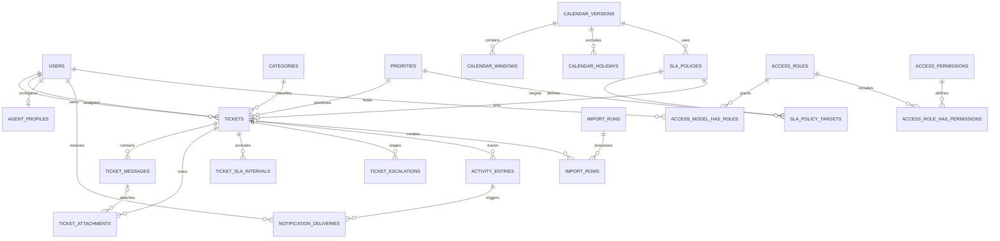

# Database design

## Status and conventions

Proposed schema, not an applied migration. After owner created `ticketms`, read-only SQL verified MySQL **8.0.33** and schema inspection returned no tables. Target the current MySQL 8.0/InnoDB with `utf8mb4` and appropriate `utf8mb4_0900_ai_ci` collation; verify engine defaults and all vendor migrations before initialization. The earlier connection error 1049 is resolved. Do not require an unapproved database-version upgrade.

- Domain primary keys: `BIGINT UNSIGNED AUTO_INCREMENT`; foreign keys match type. Laravel notification IDs retain their package UUID convention. No random UUID clustered key for tickets.
- Times: UTC `DATETIME(6)` for domain instants; Dhaka-local `DATE` for holidays and `TIME` for calendar windows. Framework/package columns retain compatible types. Display `Asia/Dhaka` in 12-hour format. Business duration is unsigned integer seconds, not floating-point hours.
- Every mutable managed entity has `created_at`, `updated_at`, `is_active BOOLEAN NOT NULL DEFAULT TRUE`, nullable `deleted_at`, and nullable `created_by`, `updated_by`, `deleted_by` user FKs as applicable. Below call these **M**. Author/owner FKs may replace redundant `created_by`. All mutable ticket services also increment `lock_version`.
- Ledgers have `created_at`/`occurred_at` and actor fields, not M or blanket soft-delete scopes. No hard-deletion UI. All domain parent references use `RESTRICT` on physical deletion; soft delete does not cascade. Operational cleanup only removes specifically approved temporary artifacts.
- Use PHP backed enums and enforced allowed-value checks on controlled strings after verifying MySQL support. Do not use MySQL ENUM for evolving lifecycle values. JSON is limited to versioned metadata, delivery payloads and safe activity diffs; no core ownership/permission fields in JSON.
- Unique identifiers remain reserved after soft deletion (email, category/priority/role names, ticket number, import external identity). Do not add nullable `deleted_at` to a composite unique key and assume it enforces active uniqueness. Restore original records instead.

## Entity map

The ERD abbreviates polymorphic package links and optional administrative activity subjects; the column definitions below are authoritative.

## Identity and configuration tables

| Table | Columns and integrity |
| --- | --- |
| `users` | Existing id/name/email/password/verification/remember fields; add M lifecycle fields and `authorization_version BIGINT DEFAULT 1`. Unique email retained. Add Tyro Login 2FA columns through verified package migrations; encrypt secrets/recovery codes and hide serialization. |
| `agent_profiles` | `id`, `user_id UNIQUE FK`, `auto_assignment_enabled BOOLEAN DEFAULT FALSE`, `last_auto_assigned_at DATETIME(6) NULL`, M. A usable agent also needs active user + effective agent role. No stored workload counter initially. |
| `categories` | `id`, `name VARCHAR(100)`, `slug VARCHAR(100) UNIQUE`, `description VARCHAR(500) NULL`, M. Disable/archive excludes new selection; existing tickets retain FK. |
| `priorities` | `id`, `name VARCHAR(50)`, `slug VARCHAR(30) UNIQUE`, `sort_order SMALLINT UNSIGNED`, M. Seed low/medium/high/critical. Referenced priority cannot be physically removed. Changing duration belongs to a policy version, not this row. |
| `calendar_versions` | `id`, `version_no INT UNIQUE`, `name VARCHAR(100)`, `timezone VARCHAR(64)`, `publication_state VARCHAR(20)` draft/published, `published_at NULL`, M. Published contents immutable. Fixed initial zone Asia/Dhaka; future timezone changes require new version. |
| `calendar_windows` | `id`, `calendar_version_id FK`, `weekday TINYINT` ISO 1–7, `opens_at TIME`, `closes_at TIME`; unique `(calendar_version_id, weekday)` initially; check close > open. No overnight or multiple shifts initially. Version children immutable after publication; no independent CRUD lifecycle. |
| `calendar_holidays` | `id`, `calendar_version_id FK`, `holiday_date DATE`, `name VARCHAR(100)`; unique `(calendar_version_id, holiday_date)`. Full-day closure only; draft editing or clone-and-publish to add/remove. Lifecycle belongs to parent version. |
| `sla_policies` | `id`, `version_no INT UNIQUE`, `name VARCHAR(100)`, `calendar_version_id FK`, `warning_percent TINYINT DEFAULT 80`, `publication_state`, `published_at NULL`, M. Percent 1–99; all usable priorities have targets before publishing. |
| `sla_policy_targets` | `id`, `sla_policy_id FK`, `priority_id FK`, `target_seconds INT UNSIGNED > 0`; unique `(sla_policy_id, priority_id)`. Immutable for published policy. |
| `ticketing_settings` | Singleton `id=1`, `current_sla_policy_id FK`, `updated_by FK`, timestamps, `lock_version`. Publish changes this pointer atomically; current policy/calendar cannot be disabled/archived until a replacement is selected. No arbitrary key/value secrets. |
| `ticket_sequences` | `year SMALLINT UNSIGNED PRIMARY KEY`, `last_number BIGINT UNSIGNED`. Internal allocator only; no soft delete/reset. Seed/create annual row safely using unique-key handling before lock/increment. |
| `command_receipts` | `id`, `operation_key CHAR(36) UNIQUE`, `actor_id FK`, `action VARCHAR(80)`, `payload_hash CHAR(64)`, `subject_type VARCHAR(100) NULL`, `subject_id BIGINT NULL`, `result_code VARCHAR(30)`, `created_at`, `completed_at NULL`. Unique key serializes command replay; actor/action/hash must match or409. Created/completed with domain mutation in same transaction; no in-flight success receipt survives rollback. Internal immutable idempotency evidence, not soft-deletable. Bulk has its own operation ledger referencing the same submitted key semantics. |

Spatie role storage uses prefixed tables configured in `config/permission.php`:

| Table | Columns and lifecycle |
| --- | --- |
| `access_roles` | Package id/name/guard/timestamps; M active/deleted fields, plus `is_system BOOLEAN DEFAULT FALSE`. Unique `(name, guard_name)` across archives. App Role extends package Role; effective authorization explicitly excludes disabled/deleted roles. System admin/agent/customer roles protected from archive/disable; display labels may change but machine names cannot. |
| `access_permissions` | Package id/name/guard/timestamps; unique `(name, guard_name)`. Code-defined immutable registry, not arbitrary soft-deletable CRUD. |
| `access_model_has_roles` | Package role/model_type/model_id composite primary key and model lookup index. Model owner constrained by app to User. No lifecycle columns on pivots; changes audited. |
| `access_role_has_permissions` | Package role/permission composite PK and package FK behavior. Use package APIs and explicit audit/cache invalidation. |
| `access_model_has_permissions` | Retain package-compatible table; direct user grants prohibited by app and tested. |

Tyro RBAC tables may be created by vendor migrations; they are not an alternate source of grants. Inventory vendor migrations before initializing; isolate Spatie names and do not map its roles onto Tyro's incompatible schema. Do not delete framework/package tables to simplify this design.

## Ticket tables

### `tickets`

| Columns | Types / meaning |
| --- | --- |
| `id`, `number` | Numeric PK; `number VARCHAR(40) UNIQUE` public reference |
| `customer_id`, `created_by` | Required users FKs; owner may differ from admin/import initiator |
| `assigned_agent_id` | Nullable users FK; exactly one current owner; eligibility checked transactionally |
| `category_id`, `priority_id` | Required FKs to retained configuration rows |
| `subject`, `description` | `VARCHAR(255)`, `TEXT`; plain text |
| `status` | `VARCHAR(30)` open/in_progress/waiting_customer/resolved/closed |
| `sla_policy_id`, `calendar_version_id` | Required version FKs pinned at creation; calendar must match selected policy |
| `sla_target_seconds` | Required unsigned snapshot; priority updates choose target within pinned policy |
| `sla_started_at` | Required original UTC creation instant, immutable |
| `sla_due_at`, `sla_warning_at` | Nullable indexed UTC projections; null while stopped/paused |
| `sla_paused_at` | Nullable current waiting start; distinguish from resolution stop |
| `sla_consumed_seconds` | Nonnegative cached active-business consumption at last transition; verify against intervals, never independently editable |
| `first_breached_at` | Nullable first actual crossing time; persists through recalculation, resolution and reopening |
| `resolution_cycle` | Unsigned integer default 1; increments when reopening Resolved |
| `resolved_at`, `closed_at` | Nullable latest transition timestamps; history retains prior cycles |
| `lock_version` | Unsigned integer default 1 for stale form detection |
| M | Availability, archive, actors and timestamps |

Constraints: nonempty subject/description via validation; allowed statuses via DB check; positive target/cycle/version; closed requires resolved/closed timestamps; waiting requires paused timestamp and null projections; live open/in_progress requires nonnull projections. Published/calendar-target linkage validated inside service using locked settings/version references; cross-table invariants cannot be plain CHECK constraints. Preserve DB checks in import/bulk paths too.

### Conversation, files and SLA history

| Table | Columns and integrity |
| --- | --- |
| `ticket_messages` | `id`, `ticket_id FK`, `author_id FK`, `visibility VARCHAR(10)` public/internal, `body TEXT`, `operation_key CHAR(36) UNIQUE`, M. Text immutable after posting; admin can hide/archive with reason. No visibility conversion from internal to public. |
| `ticket_attachments` | `id`, `ticket_id FK`, `ticket_message_id NULL`, `uploaded_by FK`, `disk VARCHAR(30)`, `path VARCHAR(512) UNIQUE`, `original_name VARCHAR(255)`, `mime_type VARCHAR(127)`, `size_bytes BIGINT`, `sha256 CHAR(64)`, M. Null message = initial ticket file. Composite FK `(ticket_message_id,ticket_id)` → messages `(id,ticket_id)` with matching unique key prevents cross-ticket attachment mismatch. Note/public visibility inherited, not independently writable. |
| `ticket_sla_intervals` | `id`, `ticket_id FK`, `kind VARCHAR(20)` waiting/resolved, `started_at`, `ended_at NULL`, `started_by/ended_by NULL FKs`, `resolution_cycle`. Check end ≥ start. Serialize writes under ticket lock; generated nullable open-ticket key unique where end is null prevents >1 open exclusion interval per ticket. Check expression/generated-column support before migration. No edit/delete UI. |
| `ticket_escalations` | `id`, `ticket_id FK`, `resolution_cycle`, `stage VARCHAR(20)` approaching/breached, `threshold_at`, `detected_at`, `activity_entry_id FK`; unique `(ticket_id,resolution_cycle,stage)`. Immutable, not soft-deletable. |
| `activity_entries` | `id`, `ticket_id NULL FK`, `actor_id NULL FK`, `actor_kind VARCHAR(20)` user/system, `action VARCHAR(80)`, `visibility VARCHAR(10)` public/internal, `subject_type VARCHAR(100) NULL`, `subject_id BIGINT NULL`, `operation_key CHAR(36)`, `correlation_id CHAR(36)`, `occurred_at`, `changes JSON`, `metadata JSON`. Append-only. Unique `(operation_key,action,subject_type,subject_id)` where subject identifiers are always supplied for mutations; no message/file contents or secrets in diffs. System actions explicitly actor_kind=system. |

Record-disable/archive history lives in activity; no cascading soft deletes. Message/file access checks parent lifecycle even if child is not deleted. Initial ticket description is not duplicated as a message. User relationships use `withTrashed()` only for authorized historical attribution, never to authenticate an archived user.

## Imports, bulk actions and notifications

| Table | Columns and integrity |
| --- | --- |
| `import_runs` | `id`, `source VARCHAR(64)`, `uploaded_by FK`, `disk/path`, `checksum CHAR(64)`, `processing_status VARCHAR(30)`, `processed_rows`, `created_rows`, `invalid_rows`, `duplicate_rows` unsigned counters, `last_row_number`, `last_byte_offset BIGINT`, `error_report_path NULL`, `started_at`, `completed_at`, `failure_code NULL`, M. Counters computed/reconciled from rows, not blindly incremented on retry. `is_active=false` requests pause at row boundary. |
| `import_rows` | `id`, `import_run_id FK`, `row_number BIGINT`, `external_id VARCHAR(128) NULL`, `result VARCHAR(20)`, `ticket_id NULL FK`, `error_codes JSON NULL`, `processed_at`; unique `(import_run_id,row_number)`. No raw secret-bearing row copy. Operational identity ledger, not soft-deletable. |
| `ticket_external_references` | `id`, `source VARCHAR(64)`, `external_id VARCHAR(128)` with explicit case-sensitive `utf8mb4_0900_as_cs` collation on both, `ticket_id FK UNIQUE`, `import_run_id FK`; unique `(source,external_id)` including archived tickets. Trim values before insertion; uniqueness is case-sensitive despite general display collation. Written atomically with ticket creation; retry cannot recreate an archived imported ticket. |
| `bulk_operations` | `id`, `operation_key CHAR(36) UNIQUE`, `actor_id FK`, `module/action VARCHAR(60)`, `submitted_count`, `succeeded_count`, `failed_count`, `started_at`, `completed_at NULL`, `summary JSON`. Internal immutable summary; retry reuses operation key. |
| `bulk_operation_items` | `id`, `bulk_operation_id FK`, `subject_type`, `subject_id`, `expected_version NULL`, `result`, `error_code NULL`; unique `(bulk_operation_id,subject_type,subject_id)`. Updated until terminal then retained. No private item labels in unauthorized errors. |
| `notification_deliveries` | `id`, `activity_entry_id FK`, `recipient_id FK`, `channel` database/mail, `delivery_status` pending/processing/sent/skipped/failed, `attempts`, `available_at`, `lease_until NULL`, `notification_uuid CHAR(36)`, `payload JSON`, `last_error_code NULL`, `sent_at NULL`; unique `(activity_entry_id,recipient_id,channel)`, unique `(notification_uuid,channel)`. Durable intent with bounded immutable safe payload, not ordinary CRUD. |
| `notifications` | Laravel-compatible id/type/notifiable_type/notifiable_id/data/read_at/timestamps. Add index `(notifiable_type,notifiable_id,read_at,created_at)` if query plan warrants; UUID from delivery intent makes database-channel insert replay-safe. No public or global notification browsing. |

## Relationships

`User`: ownedTickets/createdTickets/assignedTickets HasMany; agentProfile HasOne; notifications MorphMany; roles/permissions package relations. `Ticket`: customer/creator/assignedAgent/category/priority/slaPolicy/calendarVersion BelongsTo; messages/attachments/activities/slaIntervals/escalations HasMany; externalReference HasOne. `TicketMessage`: ticket/author BelongsTo; attachments HasMany. `CalendarVersion`: windows/holidays HasMany. `SlaPolicy`: calendarVersion BelongsTo; targets HasMany. `SlaPolicyTarget`: priority BelongsTo. `ImportRun`: rows HasMany, uploader BelongsTo. Declare concrete relationship return types, immutable datetime casts and enums. Pinned SLA/calendar relations and historical lookup labels must deliberately include archived referenced versions/records, while new-selection queries exclude them; archival must never make an old ticket uncalculable. Keep broad base relationships separate from customer-visible relations; expose scoped conversation queries deliberately.

## Initial query-driven indexes

All below are candidates to validate with EXPLAIN and realistic distribution, not a promise that every combination is covered. Foreign-key implicit indexes must be reviewed to avoid duplicates.

| Table | Index / query |
| --- | --- |
| tickets | UNIQUE(number); `(deleted_at,customer_id,created_at,id)` customer list; `(deleted_at,assigned_agent_id,status,id)` agent workload/list; `(deleted_at,status,created_at,id)` active/unassigned combined with assignee index; `(deleted_at,status,sla_due_at,id)` breach scan; `(deleted_at,status,sla_warning_at,id)` warning scan |
| tickets | `(category_id,created_at,id)` category/date if measured; FULLTEXT(subject,description) keyword search. Priority/status analytics initially aggregate indexed scopes; add measured indexes rather than every possible combination. |
| ticket_messages | `(ticket_id,deleted_at,visibility,created_at,id)` paginated conversation; unique operation key; UNIQUE(id,ticket_id) composite FK target |
| ticket_attachments | `(ticket_id,deleted_at,id)`, composite message FK index |
| ticket_sla_intervals | `(ticket_id,started_at,id)`, generated open-ticket unique |
| activity_entries | `(ticket_id,occurred_at,id)`, `(subject_type,subject_id,occurred_at,id)` administrative history |
| agent_profiles | `(auto_assignment_enabled,deleted_at,last_auto_assigned_at,user_id)` eligibility |
| notification_deliveries | `(delivery_status,available_at,id)`, `(delivery_status,lease_until,id)` recovery |
| import_runs | `(uploaded_by,created_at,id)`; import_rows uniqueness plus `(import_run_id,result,row_number)` |
| access roles/pivots | Package composite keys, plus role active/deleted filtering; no unbounded permission joins per ticket row |

## Transactions and concurrency

Transaction ownership follows architecture ADR06: the public domain service method owns each atomic unit. Controllers, jobs and listeners do not open competing transactions around the same workflow. TicketService, AssignmentService and SlaService enforce the locking/integrity rules below; import/bulk services call them per row/item. Collaborating services share the outer transaction and do not independently commit required history or delivery intent.

1. Creation: settings pointer/version read consistently; sequence annual row lock/increment; create ticket + attachment metadata + external reference if imported + activity + delivery intents; commit. Stage files first and compensate rollback. Never `MAX(number)+1`.
2. Assignment mutations lock a single singleton assignment-coordinator row in `ticketing_settings` first, then tickets ascending ID and relevant users/profiles ascending ID. Count workload after lock. All manual/auto/claim/unassignment paths use same order. Serialize initially for correctness; measure throughput before relaxing. Conditional assignment also checks `assigned_agent_id IS NULL`, expected version and open state; losing claim is conflict. Settings publishing locks same row briefly, no network I/O.
3. Ticket service transitions/replies lock ticket, verify actor is still permitted, expected version, state and interval consistency; commit message/transition/projection/activity/intents together. Cross-resource role/user changes that affect assignments use coordinator→affected tickets ascending→users ascending→roles ascending ordering; all administrative membership changes use the coordinator to protect last-admin invariants. Recheck permission under lock when revocation races matter; retry bounded deadlocks rather than returning false success.
4. Escalation locks ticket, recomputes current projection, inserts unique stage + activity/intents. If resolved/paused/deleted or no longer due, skip. Historical breach discovered during transition is still captured before stopping clock.
5. Imports commit one row ticket operation + import row result + external identity together; invalid-row records commit separately. Bulk commits one item at a time. No transaction spans entire file/batch.
6. Bounded deadlock retry only on retryable DB errors; idempotency prevents repeated effects. No file/SMTP API calls inside retried closure. Report business conflicts without retrying blindly.

## Lifecycle and migration rollout

Archive/restore leaves FKs intact. Parent inactive/deleted checks are explicit in policies, queries and jobs. Do not cascade archive messages/files when archiving a closed ticket; restore reveals only children not independently archived. Reserved unique values make restore deterministic. Physically deleting users, audit, tickets or source identity requires a separately approved retention migration/process.

Future implementation: inspect all vendor migrations, verify DB creation/permissions and server version; generate new additive migrations, create lookup/config before tickets, then histories/import/delivery tables. Use safe staged backfills for populated environments. Never edit deployed migrations. Validate fresh isolated installation and upgrade from actual baseline; no database changes occurred for this documentation.
